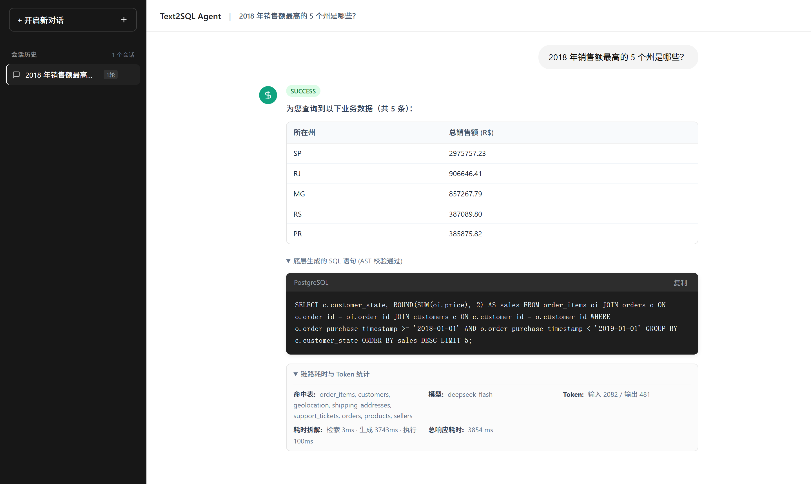
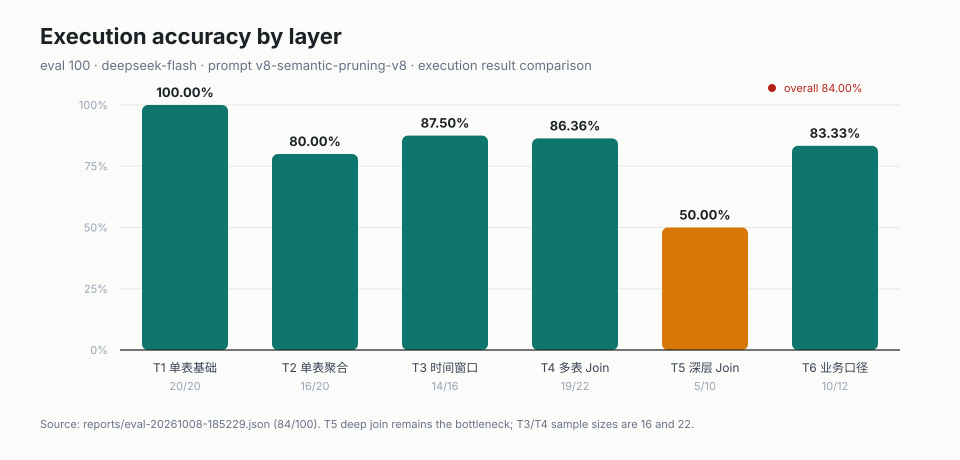
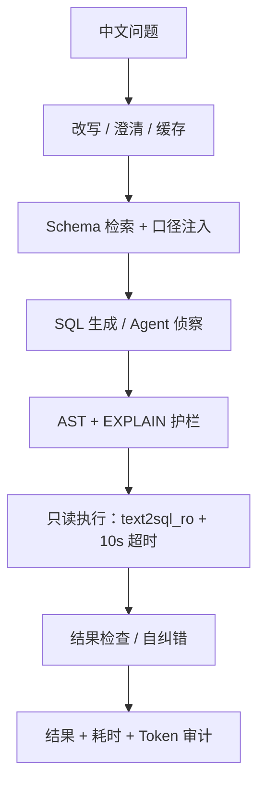

# Text2SQL Agent

> 中文业务问题 → 只读 PostgreSQL SQL → 结构化结果。基于 Olist 37 表电商数仓，面向“可评估、可解释、可归因”的 Text2SQL Agent。


**84/100 执行准确率** · **98.00% 表全召回** · **269 项测试** · **47/47 攻击拦截** · **P95 10.31s（未达标）**

[快速开始](#快速开始) · [评测方法](#评测方法) · [设计文档](#设计文档) · [已知局限](#已知局限)



*示例：2018 年销售额 Top 5 州；SQL 通过 AST 校验，底部是检索表、模型和 token/耗时分解。检索为 Top-8 召回优先，精确率见“已知局限”。*

## 这是什么 / 不是什么

- **是**：一个把中文业务问题翻译成只读 PostgreSQL SQL 的 Agent，带 Schema 检索、Join 拓扑、AST 校验、EXPLAIN 护栏、8 条启发式结果检查和结果集评测。
- **不是**：不是生产级多租户 BI；不支持写操作、多 SQL 方言、模型微调；P95 尚未达到 8s；当前单租户、无行级权限。



---

## 核心特性

- **智能 Schema 拓扑检索**  
  针对 37 张复杂业务表，基于领域词典最大匹配与连通性桥接修复，动态召回 Top-8 相关表与关联关系。DDL 上下文压缩 **78.7%**（7401 → 1580 字符），表全召回率 **98.00%**、平均召回率 **99.55%**。
- **业务口径注册表（口径注入）**  
  解耦业务概念与 SQL 生成。通过 `metrics.yml` 显式维护 GMV、复购率、客单价等复杂指标口径，根据命中关键词与依赖表精准注入 Prompt，业务语义层（T6）准确率达 **83.33%**。
- **三层只读安全护栏**  
  1. **语法与白名单校验**：基于 JSqlParser 严格拦截写操作、危险函数与跨表越权，强制结果集 LIMIT 截断；  
  2. **只读账号沙箱**：应用底层连接独立的只读角色（`text2sql_ro`），物理级防御删改库风险；  
  3. **运行时超时熔断**：10 秒强制执行超时与结果行数硬上限，47 项对抗性攻击测试 **100% 拦截**。
- **分层双级语义缓存**  
  L1 进程内 LRU + L2 数据库共享持久化（`text2sql_rw` 权限隔离）。针对高频看板与重复提问场景，缓存命中时省去模型调用（输入 Token 归零）；重复负载实验中平均延迟降低 **53%**、Token 成本降低 **50%**（命中仍需执行 SQL，延迟降至数据库执行耗时，并非 0ms）。
- **多轮对话与意图补全**  
  具备上下文记忆与指代消解能力，自动补全追问意图（如「那2017年的呢？」），多轮会话自动复用 Schema 上下文，支持会话生命周期双层缓存与结束/超时批量落库。
- **内置对话式 Web 界面**  
  启动后打开 `http://localhost:8080` 即可问数，页面展示 SQL、结果表格、分阶段耗时与 Token 审计。

---

## 系统架构

系统采用手工编排管道（Pipeline），控制流清晰透明，每一步均具备完整的可观测性与耗时统计：



---

## 核心基准表现

在包含 200 条题目（涵盖单表基础、单表聚合、时间窗口、多表 Join、深层关联、业务语义六层难度；主口径取 eval 100 条）的标准评测集上实测：

| 评测维度 | 指标表现 | 说明 |
|---|---|---|
| **综合执行准确率** | **84.0% (84/100)**<br>复跑 **85.0% (85/100)** | 基于真实 PostgreSQL 物理结果集严格对齐比对，非简单 SQL 字符串匹配；同配置独立复跑可复现 |
| **SQL 有效执行率** | **100.0% (100/100)** | AST 白名单 + EXPLAIN 算子防误杀 + 运行时自纠错，100 条均通过校验并执行成功 |
| **单表基础层（T1）** | **100.0% (20/20)** | 实体寻优规范约束，单表基础题全量满分通过 |
| **单表聚合层（T2）** | **80.00% (16/20)** | 主要错在输出列形状、聚合粒度和精度约定，不是聚合不会写 |
| **时间窗口层（T3）** | **87.50% (14/16)** | 时序与周期语义感知列保全，精准识别时间截断与时序维度 |
| **多表关联层（T4）** | **86.36% (19/22)**<br>复跑 81.82% (18/22) | 定向连接树规划（外键优先加权路径并集）+ 枚举物理列对齐；分层存在 ±1 题波动 |
| **深层关联层（T5）** | **50.00% (5/10)** | 4+ 表结构、桥接表、输出形状与口径仍是瓶颈，不回避 |
| **业务语义层（T6）** | **83.33% (10/12)**<br>复跑 **100% (12/12)** | 业务口径注入后，复杂指标（GMV/复购率/动销率/独立买家）准确率翻倍 |
| **Schema 表召回率** | **98.00% / 99.55%** | 37 张数仓表中精准召回 Top-8 关联表，平均表召回率 99.55% |
| **Prompt Token** | 平均 **2029**（复跑 1968；baseline 2315） | 检索+列剪枝收敛上下文；阶段 2 曾实测降至 709（−69.3%） |
| **总 Token（84% 轮）** | **[249,036](reports/token-summary-20261008.json)** | 104 次调用：prompt 202,935 + completion 46,101；按 100 题均 2,490 |
| **单次成本** | **0 元（单价未配置）** | token 是真实统计；金额是“没算”，不是免费 |
| **P95 延迟** | **10.31s**（复跑 **9.17s**，目标 <8s，**未达标**） | 尾部由重试与多表 Agent 侦察拉长；主口径与复跑两个数都保留 |
| **自动化测试** | **269 项全绿** | 本地含 47 条对抗用例、9 条真库集成测试；CI 无库时这 9 条自动跳过 |
| **安全攻击拦截率** | **100% (47/47)** | 恶意注入、DDL/DML、危险函数（含 schema 限定名 / 引号标识符绕过）全数硬拦截 |
| **长会话上下文压缩** | **-67.2% Token 消耗** | 5~8 轮长会话实验；滑动窗口+正则摘要压到 O(1) 量级，保留关键约束（非语义无损） |

> 详细的消融实验（Ablation Study）及评测分析请参见 [docs/EVALUATION.md](docs/EVALUATION.md)。

> **数字可核对**：上面引用的两份基准报告已随仓库提交，可以直接打开核对每一条明细——
> [reports/eval-20261008-185229.json](reports/eval-20261008-185229.json)（84% 主口径）、
> [reports/eval-20261031-153709.json](reports/eval-20261031-153709.json)（同配置复跑 85%）。
> 其余 `reports/*.json` 属于每次运行产生的中间产物，仍不入库（见 `.gitignore`）。
> 总 Token 的逐项聚合见 [reports/token-summary-20261008.json](reports/token-summary-20261008.json)；
> 原始 JSONL 默认不入库，摘要文件只保留 token 数，不含 prompt/response 内容。

---

## 快速开始

### 1. 环境准备
- **Java**: 21+
- **Maven**: 3.9+
- **Docker & Docker Compose**
- **Python**: 3.10+（用于数据校验脚本）

### 2. 启动数据库与数据初始化

```powershell
# Windows (PowerShell)
docker compose -f docker/docker-compose.yml up -d
powershell -File scripts/rebuild_db.ps1
Get-Content scripts/check_counts.sql | docker exec -i text2sql-postgres psql -U text2sql -d olist
```

```bash
# Linux / macOS (bash)
docker compose -f docker/docker-compose.yml up -d
for f in 01_olist_schema 02_load_olist 03_extend_schema 04_seed_extend 05_readonly_role 06_persistence; do
  docker exec text2sql-postgres psql -U text2sql -d olist -q -v ON_ERROR_STOP=1 -f "/data/schema/${f}.sql"
done
docker exec -i text2sql-postgres psql -U text2sql -d olist < scripts/check_counts.sql
```

> 数据库默认连接：`localhost:5432`，数据库 `olist`。数据目录通过 Docker 只读挂载到 `/data`，不会把 CSV 提交进仓库。

### 3. 配置与启动应用

默认支持任意兼容 OpenAI 协议的模型（如 DeepSeek、通义千问、百度千帆等）。先复制配置模板（模板里没有 Key，生成的 `application-local.yml` 已被 `.gitignore` 忽略）：

```bash
cp src/main/resources/application-local.example.yml src/main/resources/application-local.yml
```

```powershell
# Windows (PowerShell)：用环境变量提供 Key，Key 不落盘
$env:AGENT_LLM_API_KEY = "sk-xxxxxxxxxxxxxxxxxxxxxxxx"
mvn spring-boot:run "-Dspring-boot.run.arguments=--spring.profiles.active=local"
```

```bash
# Linux / macOS (bash)
export AGENT_LLM_API_KEY="sk-xxxxxxxxxxxxxxxxxxxxxxxx"
mvn spring-boot:run "-Dspring-boot.run.arguments=--spring.profiles.active=local"
```

> **注意**：Key 只认两个来源——环境变量 `AGENT_LLM_API_KEY`，或 `application-local.yml` 里的
> `api-key`。两者都没有时应用**照常启动**，但 `/api/ask` 会返回 `503 NOT_CONFIGURED`。
> 这是刻意的设计（数据库/校验/评估链路可以离线自检），但也是第一次跑最容易踩的坑：
> `/api/health` 里 `llmConfigured:false` 就是它。

> **运行测试**：`mvn test`（共 **269** 项，全部通过）。Mockito 5 需要的
> JVM 自附加参数已经固化在 `pom.xml` 的 surefire 配置里，**不需要再手动加参数**。

> 历史上这里记录过两个问题：`mvn test` 裸跑会因 Mockito 自附加失败，
> 以及 `SessionStoreTest.testCleanExpired` 的边界 flake。两者都已修复
> （前者固化进 pom，后者把超时判据从严格小于改成 `<=`），
> 详见 `docs/TEST_SUITE_NOTES.md`。

启动完成后：
- **Web 对话界面**：在浏览器打开 [http://localhost:8080](http://localhost:8080) 即可直接进行自然语言问数；
- **健康检查**：`GET http://localhost:8080/api/health`。

### 4. API 交互示例

```powershell
# 自然语言问数接口
$body = @{ 
    question = "2018 年销售额最高的 5 个州是哪些？" 
} | ConvertTo-Json

Invoke-RestMethod -Method Post -Uri http://localhost:8080/api/ask `
    -ContentType "application/json; charset=utf-8" -Body $body
```

**响应示例**：
```json
{
  "status": "SUCCESS",
  "sql": "SELECT c.customer_state, ROUND(SUM(oi.price)::numeric, 2) AS total_sales FROM orders o JOIN customers c ON o.customer_id = c.customer_id JOIN order_items oi ON o.order_id = oi.order_id WHERE o.order_status = 'delivered' AND o.order_purchase_timestamp >= '2018-01-01' AND o.order_purchase_timestamp < '2019-01-01' GROUP BY c.customer_state ORDER BY total_sales DESC LIMIT 5;",
  "columns": ["customer_state", "total_sales"],
  "rows": [
    ["SP", 5214832.45],
    ["RJ", 1823901.12]
  ],
  "rowCount": 5,
  "retrievedTables": ["orders", "customers", "order_items"],
  "timings": {
    "retrievalMs": 12,
    "generationMs": 1150,
    "validationMs": 4,
    "executionMs": 18,
    "totalMs": 1184
  },
  "llm": {
    "model": "deepseek-chat",
    "promptTokens": 760,
    "completionTokens": 95,
    "totalTokens": 855
  }
}
```

---

## 运行基准评估

项目内置自动化基准评测运行器，支持离线自检或大模型端到端评估：

```powershell
# 1. 离线快速链路自检（dry-run，不调用大模型，验证解析与执行链路）
mvn spring-boot:run "-Dspring-boot.run.arguments=--agent.eval.enabled=true --agent.eval.dry-run=true"

# 2. 真实大模型端到端评估（eval 集 100 条）
#    需要 Key：先设置 AGENT_LLM_API_KEY，或复制 application-local.example.yml 为 application-local.yml
mvn spring-boot:run "-Dspring-boot.run.arguments=--spring.profiles.active=local --agent.eval.enabled=true --agent.eval.split=eval"
```

> 上面第 2 条就是产出 **84%（最新复跑 85%）** 这条数字的命令，配置与
> `reports/eval-20261008-185229.json` 一致。不需要再手动加
> `--agent.retrieval.enabled` 之类的参数——`application-local.example.yml` 里已经给出主要优化开关。

---

## 评测方法

- **评估集**：200 条六层难度，按 `Math.floorMod(id.hashCode(), 2)` 切 dev/eval 各 100；few-shot 只从 dev 取，eval 只在验收时跑。
- **执行准确率**：gold SQL 与生成 SQL 都执行，`ResultNormalizer` 规范化后比较结果集；不是字符串匹配，也不是 LLM 裁判。
- **配置绑定**：报告 meta 记录模型、prompt 版本、检索开关、self-correction 等；数字离开配置没有意义。
- **dry-run**：把 gold SQL 当模型输出跑下游，先证明评估器/校验器/执行器自身没坏（默认配置 200/200）。

---

## 技术栈与选型

| 模块 | 技术选型 | 说明 |
|---|---|---|
| **核心语言 / 框架** | Java 21 / Spring Boot 3.5.16 | 现代化强类型后端底座，强类型、可测试的 Spring 生态 |
| **大模型接入** | Spring AI 1.1.8 | OpenAI-Compatible 协议适配，支持多厂商模型无缝切换 |
| **SQL 解析与 AST 校验** | JSqlParser 5.4 | 基于 AST 抽象语法树实现表/列白名单过滤、函数黑名单与 LIMIT 改写 |
| **关系型数据库** | PostgreSQL 16 | 存储 37 张电商核心业务表、语义缓存与审计日志 |
| **Schema 检索算法** | 应用层领域词典最大匹配 + 外键优先的定向连接树规划 | 解决中文在关系数据库中的分词局限与「词到表」领域映射 |
| **应用架构设计** | 手工状态编排管道（Pipeline） | 坚持状态可控与轻量化，避免框架黑盒，核心控制流透明可测 |

---

## 仓库结构

```
├── docker/                 # PostgreSQL 容器化部署
├── data/
│   ├── raw/                # 原始公开数据集说明
│   ├── schema/             # 数据库 DDL、扩展表与用户权限脚本（01~06）
│   └── eval/               # 200 条六层难度标准评估集与期望结果
├── docs/
│   ├── ROADMAP.md          # 详细系统演进路线图与架构设计问答（FAQ）
│   ├── EVALUATION.md       # 评测体系、消融实验与指标口径
│   ├── EVAL_SET.md         # 评估集难度分层规范与设计缺陷复盘
│   ├── FAILURE_ATTRIBUTION.md  # 失败逐条归因（错在哪一层）
│   ├── DEFECT_LOG.md       # 一轮"假设它有问题"的体检：24 处缺陷与修法
│   ├── TEST_SUITE_NOTES.md # 测试套件实测记录
│   └── assets/             # README 分层准确率图与演示 GIF 占位
├── reports/
│   └── README.md           # 基准评测结果汇总索引
├── scripts/                # 数据库一键重建、数据校验与成本核算脚本
└── src/
    ├── main/java/...       # 核心业务源码（接入/编排/检索/生成/校验/执行/缓存/会话）
    ├── main/resources/     # 配置文件、语义指标库与极简前端页面
    └── test/java/...       # 269 项全绿自动化单元与对抗性测试
```


---

## 已知局限

| 限制 | 现状 | 影响 |
|---|---|---|
| 深层多表 Join | T5 仅 **50.00% (5/10)** | 4+ 表结构、桥接表、输出形状仍是主要瓶颈 |
| 检索精确率 | 平均表精确率 **28.42%**（Top-8 召回优先） | 上下文有噪声表；靠生成、AST 和执行兜底，不宣称精确率 |
| P95 延迟 | **10.31s**（复跑 9.17s），目标 <8s | 尾部由重试和多表 Agent 侦察拉长，不能宣称达标 |
| 成本 | 单价未配置，报告金额为 0 | 不是免费；填真实单价后才有金额 |
| 多租户 / 数据权限 | 单租户、只读账号，无 RLS/列级权限 | 只防写，不防合法 SELECT 越权读 |
| 评估集 | 开发期看过全量，eval 也跑过多组配置 | 不能宣称“无泄漏泛化”，只能作内部回归参照 |
| Agent 模式 | 已实现、有测试，但未在评估集量出增益 | 84% 不是 Agent 跑出来的，不把功劳归给它 |
| 方言 / 写操作 / 微调 | 明确不做 | 只支持 PostgreSQL 只读 SELECT |

---

## 设计文档

| 文档 | 回答的问题 |
|---|---|
| [ROADMAP.md](docs/ROADMAP.md) | 做什么、不做什么、每个阶段的验收与取舍 |
| [EVALUATION.md](docs/EVALUATION.md) | 消融实验、指标口径、历史报告 |
| [FAILURE_ATTRIBUTION.md](docs/FAILURE_ATTRIBUTION.md) | 84% 那 16 条失败分别错在哪一层 |
| [DEFECT_LOG.md](docs/DEFECT_LOG.md) | 24 处缺陷、3 处安全绕过与修法 |
| [EVAL_SET.md](docs/EVAL_SET.md) | 评估集分层规范与设计缺陷复盘 |
| [TEST_SUITE_NOTES.md](docs/TEST_SUITE_NOTES.md) | 269 项测试的实测记录 |
| [PROJECT_GLOSSARY.md](docs/PROJECT_GLOSSARY.md) | 项目术语、类名与“别乱说”的词 |
| [SECURITY.md](SECURITY.md) | 漏洞报告方式、安全边界与已知限制 |

> 数据来源：Olist Brazilian E-Commerce Public Dataset。原始 CSV 不入库，获取方式见 [data/raw/README.md](data/raw/README.md)。

---

## Contributing

个人项目，欢迎 Issue / PR。提交前请先看 [CONTRIBUTING.md](CONTRIBUTING.md) 的代码、范围与评估集约定。

---

## 许可证

本项目基于 [MIT 许可证](LICENSE) 开源。
