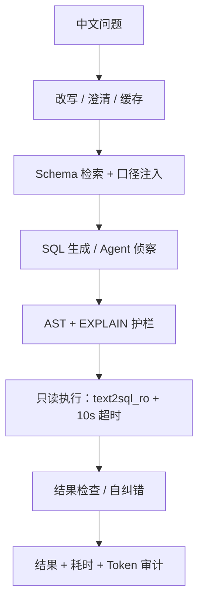

# Text2SQL Agent

> 中文业务问题 → 只读 PostgreSQL SQL → 结构化结果。基于 Olist 37 表电商数仓，面向“可评估、可解释、可归因”的 Text2SQL Agent。


**84–86/100 执行准确率（三次独立运行）** · **98.00% 表全召回** · **280 项测试** · **53/53 对抗回归** · **P95 12.06–17.27s（未达标）**

[快速开始](#快速开始) · [基准结果](#基准结果) · [评测方法](#评测方法) · [已知局限](#已知局限) · [设计文档](#设计文档)


*示例：2018 年销售额 Top 5 州；SQL 通过 AST 校验，底部是检索表、模型和 token/耗时分解。*

## 这是什么 / 不是什么

- **是**：把中文业务问题翻译成只读 PostgreSQL SQL 的 Agent，带 Schema 检索、Join 拓扑、AST 校验、EXPLAIN 护栏、8 条启发式结果检查和结果集评测。
- **不是**：不是生产级多租户 BI；不支持写操作、多 SQL 方言、模型微调；当前单租户、无 RLS；P95 未达 8s。

## 核心特性

- **Schema 检索与 Join 拓扑**：37 张表上做领域词典最大匹配 + 连通性桥接，召回 Top-8；DDL 从 7401 压到约 1277 字符（−82.7%），表全召回 98.00%、平均召回 99.55%。
- **业务口径注入**：`metrics.yml` 维护 GMV、复购率、客单价等口径，按关键词 + 依赖表注入 Prompt；T6 三次 34/36。
- **三层只读护栏**：JSqlParser AST（含 CTE 数据修改 / FROM 表函数检查）→ 只读账号 `text2sql_ro` → 10s 超时 + 200 行上限；53 条对抗回归全绿。
- **成本与缓存**：L1 LRU + L2 PostgreSQL 的 SQL 缓存（归一化精确匹配 + 配置指纹），命中省模型调用；第三次 cache-aware 实测 **¥0.221 / 100 题**（单题 ¥0.002209，cache 命中 89.27%）。
- **多轮对话与 Web UI**：指代消解、Schema 复用、会话落库；启动后打开 `http://localhost:8080` 即可问数。

## 系统架构

系统采用手工编排管道（Pipeline），每一步都有分阶段耗时与 token 审计：



## 基准结果

200 条六层评测集，主口径 eval 100 条；三次独立运行（`deepseek-flash` / `p8-semantic-pruning-v8` / local profile）：

| 维度 | 结果 |
|---|---|
| 执行准确率 | **84 / 85 / 86**（三次） |
| SQL 有效执行率 | **100%** |
| T1 / T2 / T3 | 100 / 80–85 / 81.25–87.5 |
| T4 / T5 / T6 | 81.82–86.36 / 40–60 / 91.67–100 |
| 表全召回 / 平均召回 / 精确率 | 98.00% / 99.55% / 约 28% |
| Prompt Token | 1967 / 1971 / 1994 |
| 成本 | **¥0.221 / 100 题**（cache-aware，官方空闲价） |
| P95 | 12.61 / 12.06 / 17.27s（目标 <8s，**未达标**） |
| 测试 / 安全 | 280 全绿 / 53 条对抗 |
| dry-run | 200/200 |

> 逐条明细：[第一次](reports/eval-20261108-210214.json) · [第二次](reports/eval-20261108-212550.json) · [第三次](reports/eval-20261108-221405.json) · [成本](reports/cost-20261108.json)。消融、历史口径与成本公式见 [docs/EVALUATION.md](docs/EVALUATION.md)。

## 快速开始

### 1. 环境

Java 21、Maven 3.9、Docker、Python 3.10（数据脚本）。

### 2. 数据库

```powershell
docker compose -f docker/docker-compose.yml up -d
powershell -File scripts/rebuild_db.ps1
```

```bash
docker compose -f docker/docker-compose.yml up -d
for f in 01_olist_schema 02_load_olist 03_extend_schema 04_seed_extend 05_readonly_role 06_persistence; do
  docker exec text2sql-postgres psql -U text2sql -d olist -q -v ON_ERROR_STOP=1 -f "/data/schema/${f}.sql"
done
```

数据库默认 `localhost:5432/olist`；CSV 通过 Docker 只读挂载，不进仓库。

### 3. 配置与启动

```bash
cp src/main/resources/application-local.example.yml src/main/resources/application-local.yml
```

```powershell
$env:AGENT_LLM_API_KEY = "sk-xxxxxxxx"
mvn spring-boot:run "-Dspring-boot.run.arguments=--spring.profiles.active=local"
```

Key 只认环境变量 `AGENT_LLM_API_KEY` 或 `application-local.yml` 的 `api-key`。没配 Key 也能启动，但 `/api/ask` 会返回 `503 NOT_CONFIGURED`。

### 4. API

```powershell
$body = @{ question = "2018 年销售额最高的 5 个州是哪些？" } | ConvertTo-Json
Invoke-RestMethod -Method Post -Uri http://localhost:8080/api/ask `
    -ContentType "application/json; charset=utf-8" -Body $body
```

```json
{
  "status": "SUCCESS",
  "sql": "SELECT ... LIMIT 5;",
  "rowCount": 5,
  "retrievedTables": ["orders", "customers", "order_items"],
  "timings": {"retrievalMs": 12, "generationMs": 1150, "validationMs": 4, "executionMs": 18},
  "llm": {"model": "deepseek-chat", "promptTokens": 760, "completionTokens": 95}
}
```

### 5. 测试与评估

```bash
mvn test   # 280 项
```

```powershell
powershell -ExecutionPolicy Bypass -File scripts/run_eval.ps1 -Split eval
powershell -ExecutionPolicy Bypass -File scripts/run_eval.ps1 -Split all -DryRun
```

```bash
bash scripts/run_eval.sh eval
DRY_RUN=true bash scripts/run_eval.sh all
```

`-DryRun` 不调模型，只跑 gold SQL 自检；真实 eval 需要 `AGENT_LLM_API_KEY`。

## 评测方法

- **评估集**：200 条六层难度，按 `Math.floorMod(id.hashCode(), 2)` 切 dev/eval 各 100；few-shot 只从 dev 取。
- **执行准确率**：gold SQL 与生成 SQL 都执行，`ResultNormalizer` 规范化后比较结果集；不是字符串匹配，也不是 LLM 裁判。
- **配置绑定**：报告 meta 记录模型、prompt 版本、检索开关、self-correction；数字离开配置没有意义。
- **dry-run**：把 gold SQL 当模型输出跑下游，证明评估器/校验器/执行器自身没坏；本轮 200/200。

## 技术栈

| 模块 | 选型 |
|---|---|
| 语言 / 框架 | Java 21 / Spring Boot 3.5.16 |
| LLM 接入 | Spring AI 1.1.8（OpenAI 兼容，手工装配） |
| SQL 解析 | JSqlParser 5.4 |
| 数据库 | PostgreSQL 16 |
| 编排 | 手工 Pipeline（非框架黑盒） |

## 仓库结构

```
src/main/java        # 接入 / 编排 / 检索 / 生成 / 校验 / 执行 / 缓存 / 会话
src/main/resources   # 配置、glossary / metrics / few-shot、前端
src/test/java        # 280 项测试
data/schema          # DDL + 只读/读写角色
data/eval            # 200 条评估集
docs/                # ROADMAP / EVALUATION / FAILURE_ATTRIBUTION ...
reports/             # 三次 eval + token + cost
scripts/             # 重建库、评估、成本
docker/              # PostgreSQL 容器
```

## 已知局限

| 限制 | 现状 |
|---|---|
| 深层多表 Join | T5 **40–60%**；10 条样本，±1 题就是 10pp |
| 检索精确率 | 约 **28%**（Top-8 召回优先，噪声表靠生成/AST/执行兜底） |
| P95 延迟 | **12–17s**，目标 <8s，未达标 |
| 多租户 / 权限 | 单租户、只读账号、无 RLS |
| 评估集 | 开发期看过全量，只能作内部回归参照，不宣称无泄漏泛化 |
| Agent 模式 | 已实现、有测试，但未在评估集量出增益；84–86 不是 Agent 跑出来的 |

## 设计文档

| 文档 | 回答的问题 |
|---|---|
| [ROADMAP.md](docs/ROADMAP.md) | 做什么、不做什么、每阶段验收与取舍 |
| [EVALUATION.md](docs/EVALUATION.md) | 消融、指标口径、历史报告、成本公式 |
| [FAILURE_ATTRIBUTION.md](docs/FAILURE_ATTRIBUTION.md) | 三次 15+14+16 条失败分别错在哪一层 |
| [DEFECT_LOG.md](docs/DEFECT_LOG.md) | 缺陷、安全绕过与修法 |
| [SECURITY.md](SECURITY.md) | 安全边界与漏洞报告方式 |

> 数据来源：Olist Brazilian E-Commerce Public Dataset；原始 CSV 不入库，见 [data/raw/README.md](data/raw/README.md)。

---

MIT License · 个人项目，欢迎 Issue / PR；提交前看 [CONTRIBUTING.md](CONTRIBUTING.md)。
